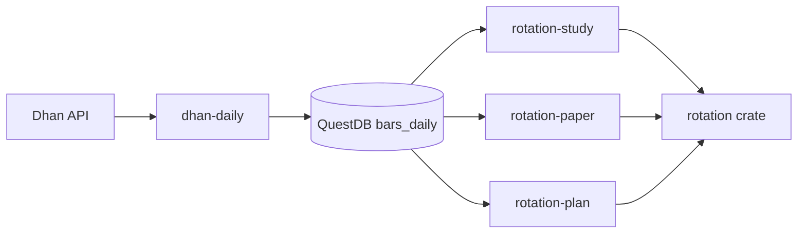

# Building blocks

## Crates

| Crate | Job |
|---|---|
| `rotation` | The strategy: daily-bar panel, point-in-time universe, `momentum` and `momentum_low_vol` rankings, monthly schedule, backtest, day-by-day paper account, and the monthly plan and orders ([Momentum rotation](strategies/rotation.md)) |
| `store` | Writes rows into QuestDB over QWP (used by `dhan-daily`) |
| `dhan` | Dhan REST API, instrument list, automatic login |

## Tools

| Command | Job |
|---|---|
| `dhan-daily` | Downloads daily candles for every NSE stock into `bars_daily` |
| `dhan-token` | Checks that Dhan login works |
| `rotation-paper` | Paper account: fills at the open, daily report and alerts, orders for the next open |
| `rotation-plan` | Target holdings and orders from your real holdings on a rebalance day |
| `rotation-study` | The backtests behind the strategy: comparisons, stability, exits, capacity |
| `scripts/rotation_daily.sh` | Evening job: `dhan-daily` for the last 10 days, then `rotation-paper run` |
| `scripts/questdb.sh` | Starts, stops and sets up QuestDB |
| `scripts/questdb_mcp.py` | Lets Claude query QuestDB |
