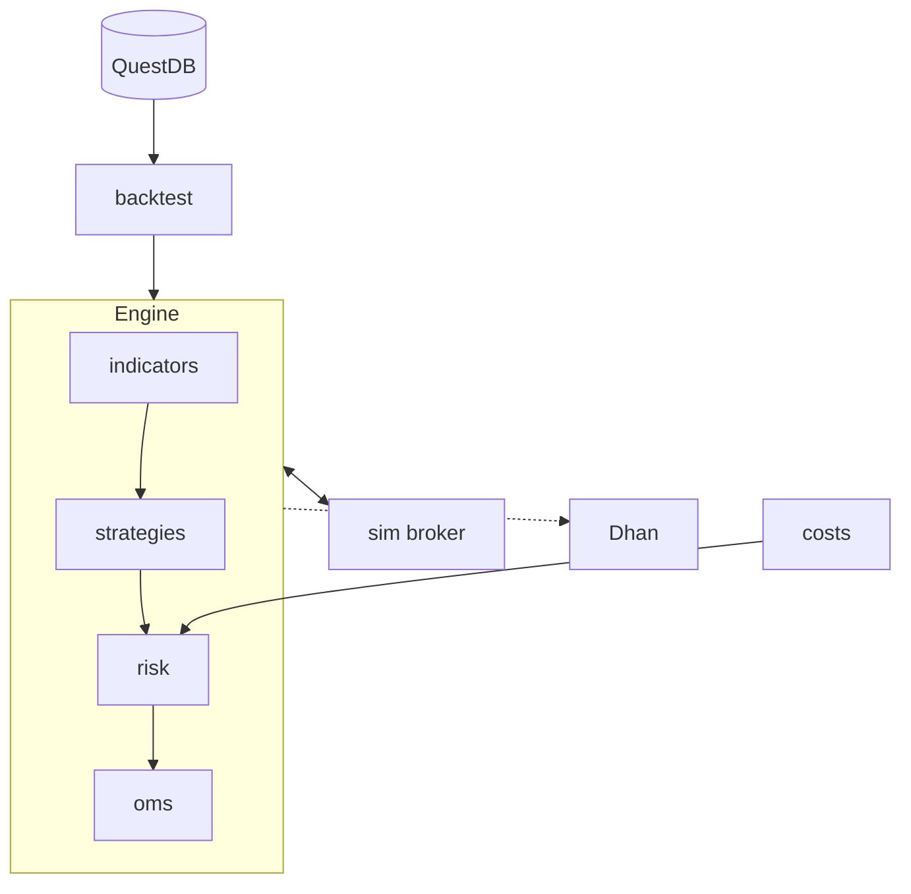

# Building blocks

Each piece does one job and can be tested alone.

## Core

| Crate | Job |
|---|---|
| `core` | The shared language: prices, bars, orders, positions, time |
| `indicators` | SMA, EMA, RSI, ATR, VWAP, opening range and more, asked for by name |
| `strategies` | Turn bars into signals. Home of ORB and a template to copy |
| `costs` | Brokerage, taxes, fees and slippage |
| `risk` | Trade size, exposure caps, the daily loss halt |
| `oms` | Tracks every order and position |
| `engine` | Connects all of the above |

## Testing

| Crate | Job |
|---|---|
| `sim` | Synthetic market data, and a simulated broker that can misbehave on purpose |
| `backtest` | Runs a strategy over history and writes a report |

## Data and broker

| Crate | Job |
|---|---|
| `store` | Reads and writes QuestDB |
| `brokers/dhan` | Dhan REST API, live feeds, automatic login |

## Tools

| Command | Job |
|---|---|
| `backtester` | Runs a backtest from a config file |
| `dhan-history` | Downloads 1-minute candles into QuestDB |
| `dhan-token` | Checks that Dhan login works |
| `synth-bars` | Loads synthetic bars into QuestDB |
| `scripts/questdb.sh` | Starts, stops and sets up QuestDB |
| `scripts/questdb_mcp.py` | Lets Claude query QuestDB |

## Indicators available

| Spec | Gives |
|---|---|
| `sma(n)`, `ema(n)` | Moving averages |
| `rsi(n)` | Relative strength, 0–100 |
| `atr(n)` | Average range per bar |
| `atr_daily(n)` | Average range per day, from finished days |
| `vwap` | Volume-weighted average price, reset daily |
| `vol_sma(n)` | Average bar volume; `.prev` excludes the current bar |
| `vol_tod(n)` | Normal volume for this minute of the day |
| `turnover(n)` | Average daily traded value |
| `orb(n)` | Opening range: `.high`, `.low`, `.range` |
| `prev_day` | Yesterday's `.high`, `.low`, `.close` |
