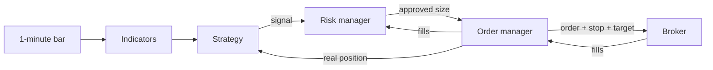

# Life of a trade

Every minute, each stock produces one candle. Here is what happens to it.

## An example

A ₹500 stock has an opening range of ₹498 to ₹502, and it just closed at ₹502.50 on heavy volume.

**1. Indicators update.** Each indicator is computed once per stock, however many strategies use it. A bar takes about 20 nanoseconds for eight indicators.

**2. The strategy decides.** ORB sees a valid breakout and emits a signal: *go long at ₹503.05, stop ₹498, target ₹513.15*. It says what it wants, never how much.

**3. Breakouts are ranked.** ORB waits until every stock's bar for that minute is in. If there are more breakouts than slots, the strongest by relative volume go first.

**4. The risk manager sizes it.** It picks 60 shares (₹30,183), checks the most it could lose (₹303) and that the reward is worth the cost. It also checks the exposure and margin limits. [How sizing works](risk-and-costs.md).

**5. The order manager sends it.** Entry, stop and target go to the broker as one order, so protection exists from the first second.

**6. The trade plays out.** It ends at the broker's stop or target, or when the strategy or clock exits it. By 15:10 everything is closed.

## What happens each minute

| Step | Who | What |
|---|---|---|
| 1 | Broker | Reports fills and order updates |
| 2 | Engine | Updates indicators and marks positions to market |
| 3 | Strategies | See the bar and emit signals |
| 4 | Risk, orders | Approve and send |
| 5 | Minute end | Strategies compare stocks; the clock checks square-off |

## Rules no strategy can break

The engine enforces these, so a new strategy can't get them wrong.

- No entries after 14:45, on a bad feed, or in a stock marked untradable.
- Every entry passes the risk manager.
- A strategy can only touch its own trade.
- One position per stock across all strategies, because the broker nets them.
- Square-off at 15:10 runs from the clock, even if a stock's data has stopped.
