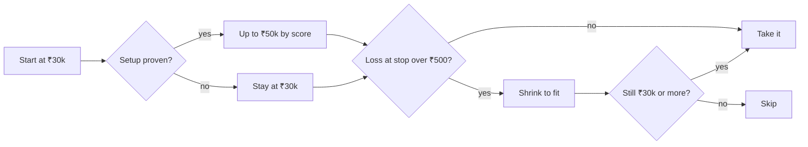

# Risk and costs

## How big is a trade?

More money goes to better setups, but only once out-of-sample results show they deserve it. Until then, every trade is the minimum size.

**Example:** a top-scored trade with entry ₹500 and stop ₹494 risks ₹6 a share. ₹500 ÷ ₹6 = 83 shares, so ₹41,500 instead of ₹50,000.

## The limits

| Limit | Default | Why |
|---|---|---|
| Exposure per trade | ₹30k–₹50k | Many small positions |
| Maximum loss per trade | ₹500 | 0.1% of capital |
| Reward vs cost | At least 4× | Small targets just pay the broker |
| Positions per stock | One | The broker nets everything per stock |
| Total exposure | ₹15 lakh | 3× capital |
| Net long or short | ₹7.5 lakh | Thirty longs on a falling day are one bet |
| Daily loss | ₹10,000 | 2% of capital: stops all new trades and closes everything |

Margin uses each stock's real leverage, because 5× isn't available on every stock.

## What a trade costs

Rates from [Dhan's pricing page](https://dhan.co/pricing/), read in November 2026. Check them again before trading real money.

| Charge | Rate | Side |
|---|---|---|
| Brokerage | 0.03%, max ₹20 per order | Both |
| STT | 0.025% | Sell |
| Exchange | 0.0030699% | Both |
| SEBI | ₹10 per crore | Both |
| Stamp duty | 0.003% | Buy |
| GST | 18% of brokerage, exchange and SEBI | Both |

We also assume **slippage** of 0.02% per fill, at least one tick.

## Why costs matter so much

| Position (₹500 stock) | Charges + slippage, round trip | % of position |
|---|---|---|
| ₹30,000 | ₹44 | 0.15% |
| ₹50,000 | ₹74 | 0.15% |
| ₹1,00,000 | ₹122 | 0.12% |

So a target has to be at least about **0.6%** away to clear the 4× rule.

Four trades a day for a year at ₹40,000 is about ₹60,000 in costs, or 12% of the ₹5 lakh capital, before making a rupee. Every trade pays this whether it wins or not, which is why fewer, better trades can beat many small ones.
